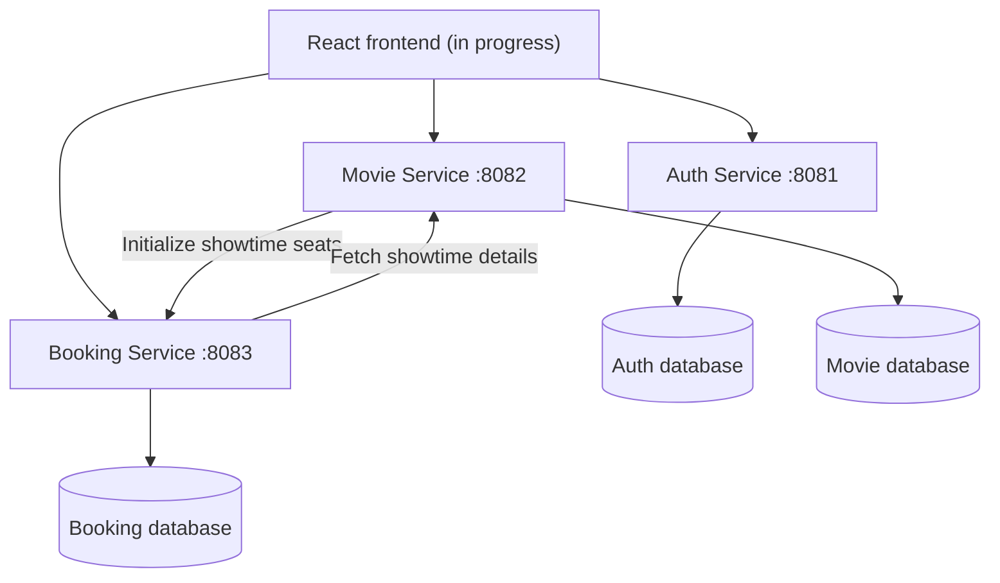
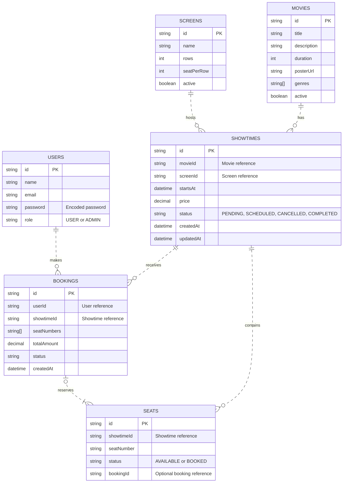

# MovieReservation — Movie Seat Reservation System

A full-stack movie seat reservation project built for the General Assembly Java Development Bootcamp one-day microservices hackathon.

## Overview

MovieReservation separates user authentication, cinema scheduling, and seat booking into three Spring Boot services. Users can register, log in, browse movie information and showtimes, and reserve seats. The backend protects seat inventory from competing reservations with atomic MongoDB updates, a unique seat index, and transactions.

**Current repository state:** The backend controllers, models, repositories, and inter-service clients are implemented. Dockerfiles and Compose are included. The React frontend currently contains the default Vite starter screen; production-ready booking pages and a complete end-to-end demonstration are still to be completed/verified.

## Problem statement

Cinema customers may try to book the same seat simultaneously. A read-then-write implementation could sell one seat twice. This project uses a seat-level conditional update (`AVAILABLE` → `BOOKED`) and database uniqueness constraints so only one competing request can claim a seat.

## Team

| Member | Area |
| --- | --- |
| Shaika Mohamed | Authentication, registration and login |
| Israa Husain | Movies and cinema screens |
| Fatima Abdulla | Showtimes, seat-number generation, Showtime integration |
| Mariam Baloch | Bookings, seat inventory, concurrency control |

## Technology stack

- **Backend:** Java 17, Spring Boot 4.1.2, Spring Security, Spring Data MongoDB, Maven, Lombok, MapStruct, REST APIs
- **Authentication:** JWT, role-based access control (`USER`, `ADMIN`)
- **Database:** MongoDB 8.0 locally through Docker Compose, or MongoDB Atlas through connection strings
- **Frontend:** React, Vite, JavaScript (UI still in progress)
- **Tooling:** Docker, Docker Compose, Git, GitHub, Postman

## Microservices architecture

| Service | Port | Database | Responsibilities |
| --- | --- | --- | --- |
| Auth Service | `8081` | `moviereserve_auth` | Register users, authenticate credentials, issue JWTs, user identity |
| Movie Service | `8082` | `moviereserve_movies` | Movie and screen CRUD, showtime scheduling and ticket prices, generate seat numbers |
| Booking Service | `8083` | `moviereserve_bookings` | Initialize seat inventory, reserve/cancel bookings, seat availability and concurrency protection |



Each service owns its own collections; cross-service references use IDs and REST calls rather than foreign keys across databases.

## Database design

| Database | Collection | Main fields |
| --- | --- | --- |
| Auth | `users` | `id`, `name`, `email`, encoded `password`, `role` |
| Movie | `movies` | `id`, `title`, `description`, `duration`, `posterUrl`, `genres`, `active` |
| Movie | `screens` | `id`, `name`, `rows`, `seatPerRow`, `active` |
| Movie | `showtimes` | `id`, `movieId`, `screenId`, `startsAt`, `price`, `status`, `createdAt`, `updatedAt` |
| Booking | `seats` | `id`, `showtimeId`, `seatNumber`, `status`, `bookingId` |
| Booking | `bookings` | `id`, `userId`, `showtimeId`, `seatNumbers`, `totalAmount`, `status`, `createdAt` |

`movieId`, `screenId`, `showtimeId`, and `userId` are references by ID. A unique compound MongoDB index protects `(showtimeId, seatNumber)`. The Booking model also declares a partial unique index for confirmed bookings over `(showtimeId, seatNumbers)`.

Showtime statuses in the backend are `PENDING`, `SCHEDULED`, `CANCELLED`, and `COMPLETED`. Seat statuses include `AVAILABLE` and `BOOKED`. A showtime's `startsAt` stores its date and time together.

## API endpoints

### Auth Service — `http://localhost:8081`

| Method | Endpoint | Purpose |
| --- | --- | --- |
| POST | `/auth/register` | Register a user |
| POST | `/auth/login` | Log in and receive JWT |
| GET | `/auth/me` | Return authenticated identity |

### Movie Service — `http://localhost:8082`

| Method | Endpoint | Purpose |
| --- | --- | --- |
| GET | `/api/movies` | List active movies |
| GET | `/api/movies/{id}` | Get active movie |
| POST | `/api/movies` | Create movie (ADMIN) |
| PUT | `/api/movies/{id}` | Update movie (ADMIN) |
| DELETE | `/api/movies/{id}` | Soft-delete movie (ADMIN) |
| GET | `/api/screens` | List active screens |
| GET | `/api/screens/{id}` | Get active screen |
| POST | `/api/screens` | Create screen (ADMIN) |
| PUT | `/api/screens/{id}` | Update screen (ADMIN) |
| DELETE | `/api/screens/{id}` | Soft-delete screen (ADMIN) |
| GET | `/api/showtimes` | List showtimes |
| GET | `/api/showtimes/{id}` | Get a showtime |
| GET | `/api/showtimes/movie/{movieId}` | Get showtimes for a movie |
| POST | `/api/showtimes` | Create showtime and request seat initialization (ADMIN) |
| PUT | `/api/showtimes/{id}` | Update showtime (ADMIN) |
| DELETE | `/api/showtimes/{id}` | Delete showtime (ADMIN) |

Example showtime creation request:

```json
{
  "movieId": "movie-id",
  "screenId": "screen-id",
  "startsAt": "2026-11-10T19:30:00",
  "price": 4.000
}
```

### Booking Service — `http://localhost:8083`

| Method | Endpoint | Purpose |
| --- | --- | --- |
| POST | `/api/bookings` | Reserve seats |
| GET | `/api/bookings/users/{userId}` | List a user's bookings |
| GET | `/api/bookings/showtimes/{showtimeId}/seats` | List seats for a showtime |
| DELETE | `/api/bookings/{bookingId}?userId={userId}` | Cancel a booking |
| POST | `/api/showtimes/{showtimeId}/seats` | Initialize showtime seat inventory (service-to-service) |

Example booking request (current API accepts `userId` from the body):

```json
{
  "userId": "user-id",
  "showtimeId": "showtime-id",
  "seatNumbers": ["A1", "A2"]
}
```

Example seat initialization request:

```json
{"seatNumbers": ["A1", "A2", "A3", "B1", "B2", "B3"]}
```

## Booking and concurrency design

1. An administrator creates a showtime referencing an active movie and screen.
2. Movie Service generates seat identifiers such as `A1`, `A2`, `B1` from the screen layout.
3. Showtime starts in `PENDING`. Movie Service calls Booking Service to initialize the seats. On successful initialization, Showtime changes to `SCHEDULED`.
4. Booking Service fetches the showtime from Movie Service, checks that it is scheduled and has not started, and calculates the total price.
5. For each requested seat, Booking Service performs an atomic conditional MongoDB update only if the seat is currently `AVAILABLE`.
6. If a concurrent request loses the race, it receives `409 Conflict`. Booking creation and seat updates are wrapped in a MongoDB transaction so a failed multi-seat booking can roll back together.
7. Cancellation changes a confirmed booking to cancelled and releases its seats, provided the showtime has not started.

The `SeatRepository` uses conditional `@Query`/`@Update` operations; the `Seat` model declares a compound unique index. The Booking Service configures a `MongoTransactionManager`. **There is no explicit Java `ReentrantLock` or `ExecutorService` implementation in this ZIP**; if the hackathon rubric requires those specifically, add and demonstrate them separately.

## Security

- Auth Service hashes passwords and issues signed JWTs after successful login.
- New registrations receive `USER` role by default. ADMIN users must be provisioned securely.
- Movie Service validates Bearer JWTs using the shared `JWT_SECRET` and restricts movie/screen/showtime mutations to `ADMIN`.
- Movie, screen, and showtime GET endpoints are public.
- **Integration still to verify:** Booking Service currently accepts `userId` in request parameters/body and does not show equivalent JWT enforcement. Do not treat its user-specific endpoints as securely authorized until implemented.
- Do not commit database credentials, JWT secrets, or `.env` files.

## Project structure

```text
MovieReservation/
├── backend/
│   ├── auth-service/       # JWT authentication, users
│   ├── movie-service/      # movies, screens, showtimes
│   └── booking-service/    # bookings, seats, concurrency
├── frontend/               # React + Vite starter; UI in progress
├── docker-compose.yml
├── .env.example
└── README.md
```

Each backend service contains its own `pom.xml`, `Dockerfile`, and layered Spring Boot packages (controller, service, repository, model, DTOs, and relevant configuration).

## Running locally with IntelliJ

Prerequisites: Java 17, Docker Desktop or a reachable MongoDB Atlas cluster, and Node.js/npm for the frontend.

1. Clone the repository and open `MovieReservation` in IntelliJ.
2. Start MongoDB locally (see Docker section), or prepare Atlas URIs.
3. Create individual IntelliJ run configurations for `AuthServiceApplication`, `MovieServiceApplication`, and `BookingServiceApplication`.
4. Give each configuration its own `MONGODB_URI`. Both Auth and Movie Services also require the same `JWT_SECRET`.
5. Start services on ports `8081`, `8082`, and `8083`, respectively.
6. Start the frontend:

```bash
cd frontend
npm install
npm run dev
```

The current frontend displays the Vite starter; it does not yet expose the complete user journey.

## Docker Compose setup (local MongoDB)

The current `docker-compose.yml` builds **three backend services** and starts **MongoDB 8.0** as a single-node replica set. MongoDB is published to the host at `127.0.0.1:27018`; containers connect to it at `mongodb:27017`. Data is kept in the named `mongodb_data` volume. The frontend is **not** currently included in Compose.

Compose uses these per-service files (they are not committed and must be created on each machine):

**`backend/auth-service/.env`**

```dotenv
MONGODB_URI=mongodb://mongodb:27017/moviereserve_auth?replicaSet=rs0
JWT_SECRET=replace_with_a_secure_shared_secret_of_32_to_63_bytes
```

**`backend/movie-service/.env`**

```dotenv
MONGODB_URI=mongodb://mongodb:27017/moviereserve_movies?replicaSet=rs0
JWT_SECRET=replace_with_the_exact_same_shared_secret
BOOKING_SERVICE_URL=http://booking-service:8083
```

**`backend/booking-service/.env`**

```dotenv
MONGODB_URI=mongodb://mongodb:27017/moviereserve_bookings?replicaSet=rs0
MOVIE_SERVICE_BASE_URL=http://movie-service:8082
```

Run from the repository root:

```bash
docker compose up --build -d
docker compose ps
docker compose logs -f auth-service
```

To stop containers without removing the database volume:

```bash
docker compose down
```

**Configuration issue to resolve:** the current Compose file sets `BOOKING_SERVICE_BASE_URL` for Movie Service, but its `application.properties` reads `BOOKING_SERVICE_URL`. Set `BOOKING_SERVICE_URL=http://booking-service:8083` in Movie Service's `.env` (as above) or correct the Compose variable; otherwise it falls back to `localhost:8083` inside the container and inter-service calls fail. The root `.env.example` is informational and is **not** automatically mapped into those three `env_file` paths.

## MongoDB Atlas alternative

MongoDB Atlas can replace the local database container when you use Atlas connection strings in each microservice's `MONGODB_URI`. Create database users and allow the development machine/network in Atlas Network Access. Keep the same logical database separation. Atlas handles replica sets; do not append the local `replicaSet=rs0` setting to Atlas SRV URIs. The current Compose file still starts its local MongoDB container unless modified.

## Entity Relationship Diagram



**Database ownership:**

- **Auth Service:** `users`
- **Movie Service:** `movies`, `screens`, `showtimes`
- **Booking Service:** `seats`, `bookings`

Relationships represent logical ID references in MongoDB, rather than database-enforced foreign keys. Each seat is unique within a showtime through the compound index `(showtimeId, seatNumber)`. The booking-to-seat relationship represents the seats currently assigned to a booking; cancellation releases those seats while the booking retains its `seatNumbers`.
## Possible enhancements

JWT authorization and user identity in Booking Service, React UI completion, WebSocket seat updates, email notifications, reservation timeouts, automated concurrent-request tests, API gateway, CI/CD, and cloud deployment.
